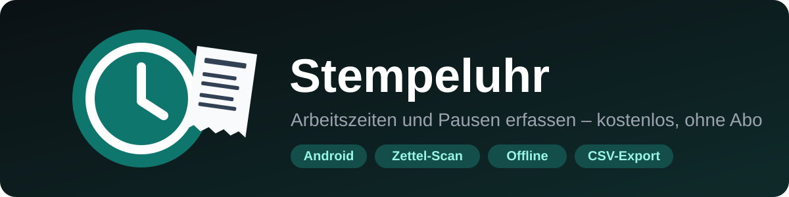
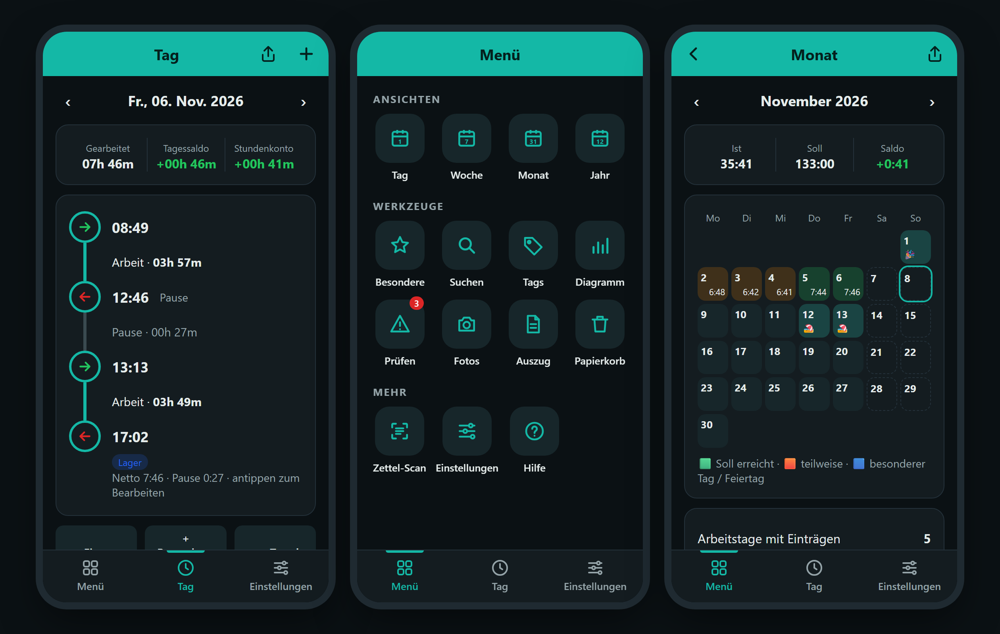

<p align="center">
  
</p>

<p align="center">
  <b>Arbeitszeiten und Pausen am Handy stempeln – ohne Abo, ohne Konto, ohne Werbung.</b><br>
  Alle Daten bleiben auf deinem Gerät. Stundenzettel vom Stempel-Terminal einfach abfotografieren.
</p>

<p align="center">
  <a href="https://github.com/Barry2040/stempeluhr/releases/latest/download/Stempeluhr.apk"><b>⬇ APK herunterladen (Android)</b></a>
</p>

> [!WARNING]
> **Vibe-coded:** Dieses Projekt ist mit KI-Unterstützung (Claude) im „Vibe Coding“ entstanden – im Gespräch,
> Schritt für Schritt, ohne klassische Code-Reviews. Es kann daher **Fehler enthalten**.
> Getestet wurde nur das, was unten unter [Teststatus](#-teststatus) als „getestet“ markiert ist. Mach regelmäßig ein Backup.
> Fehler und Ideen gerne als [Issue](https://github.com/Barry2040/stempeluhr/issues) melden.

<p align="center">
  
</p>

---

## ✨ Funktionen

| | |
|---|---|
| ⏱️ **Stempeln** | Einstempeln, Pause, Pause beenden, Ausstempeln – mit Live-Zeit für heute |
| 🕒 **Tag als Zeitleiste** | Jeder Stempel als Punkt, dazwischen Arbeits- und Pausenblöcke; Gearbeitet, Tagessaldo und Stundenkonto auf einen Blick; zum Blättern wischen |
| 📅 **Woche, Monat, Jahr** | Wochenliste mit Fortschrittsbalken, Monatskalender (Soll erreicht / teilweise / besonderer Tag), Jahresübersicht mit Urlaubskonto |
| 📷 **Zettel-Scan** | Stundenzettel (Bon vom Zeiterfassungs-Terminal) fotografieren – Arbeitsblöcke und Pausen werden **offline** erkannt, mit der gedruckten Tagessumme gegengeprüft und übernommen |
| 🔁 **Täglich neu scannen** | Wächst dein Zettel jeden Tag um einen Tag, scannst du einfach den ganzen Zettel – vorhandene Tage werden übersprungen, geänderte ersetzt |
| ⭐ **Besondere Tage** | Urlaub, Krank, Feiertag, Schule, Sonderurlaub, Überstundenabbau – auch als Zeitraum und als halber Tag |
| 🎉 **Feiertage** | Gesetzliche Feiertage aller 16 Bundesländer werden automatisch berücksichtigt |
| 🏷️ **Tags** | Einträge nach Projekt, Baustelle oder Kunde markieren – farbig, durchsuchbar, im Diagramm ausgewertet |
| 🔍 **Suchen** | Nach Notiz, Tag, Datum oder Wochentag suchen, mit Zeitraum-Filter und Summe |
| 📊 **Diagramm** | Ist gegen Soll je Woche, Monat oder Jahr, plus Verteilung nach Tags |
| ⚠️ **Prüfen** | Findet vergessene Stempel, Überschneidungen, Arbeitstage ohne Eintrag und (abschaltbar) Verstöße gegen das Arbeitszeitgesetz: Pausen, max. 10 Std., 11 Std. Ruhezeit |
| 🖼️ **Fotos** | Gescannte Zettel und eigene Fotos werden dem Tag zugeordnet und bleiben auf dem Handy |
| 📤 **Auszug** | Beliebiger Zeitraum als Bericht (HTML, druckbar als PDF) oder CSV für Excel, Tag als Text teilen |
| 🗑️ **Papierkorb** | Gelöschte Einträge und besondere Tage 30 Tage lang wiederherstellbar |
| ⚖️ **Soll / Ist / Saldo** | Sollstunden und Arbeitstage einstellen, Überstundenkonto über alle Monate, Startsaldo für alte Überstunden |
| ☕ **Mindestpause** | Optional: gesetzliche Pause (30 Min. ab 6 Std., 45 Min. ab 9 Std.) automatisch abziehen |
| 💾 **Backup** | Alle Daten als JSON sichern und wiederherstellen |
| 🔄 **Updates** | Die App meldet sich, wenn es eine neue Version gibt – ein Tipp lädt sie herunter |
| 🌙 **Hell & Dunkel** | Folgt automatisch dem Design deines Handys |

## 🚀 Loslegen

1. **[Stempeluhr.apk](https://github.com/Barry2040/stempeluhr/releases/latest/download/Stempeluhr.apk)** auf dem Handy herunterladen.
2. Datei öffnen und **„Installation aus unbekannten Quellen“** für Browser bzw. Dateimanager erlauben.
3. In den **Einstellungen** Sollstunden pro Tag, Arbeitstage, Urlaubsanspruch und Bundesland eintragen – fertig.

> [!TIP]
> **Updates:** Gibt es eine neue Version, fragt die App beim Start, ob sie sie herunterladen soll. Download öffnen,
> **„Installieren“** – deine Daten bleiben erhalten. In den Einstellungen kannst du auch selbst nach Updates suchen.

## 📷 Stundenzettel scannen

Im **Menü** → **Zettel fotografieren** oder **Zettel aus Galerie** (oder auf „Tag“ unten **📷 Zettel**). Die App erkennt Zettel in diesem Aufbau:

```
Montag, 2. November 2026 (06:48)
02.11. 09:53:10 - 02.11. 14:05:21
02.11. 14:29:05 - 02.11. 17:05:17
```

Jede Zeile ist ein Arbeitsblock, die Lücke dazwischen wird als Pause eingetragen. In der Vorschau siehst du jeden Tag mit
Status (**neu**, **schon vorhanden**, **ersetzt vorhandene …**) und wählst per Haken, was übernommen wird.

> [!NOTE]
> Für gute Ergebnisse: Zettel flach hinlegen, gerade von oben, gutes Licht, ganz im Bild. Angeschnittene Ziffern am Zeilenanfang
> sind kein Problem – das Datum kommt aus der Tagesüberschrift. Unter **„Erkannter Text“** siehst du, was die Texterkennung gelesen hat.
> Dein Zettel sieht anders aus? Lege ein [Issue](https://github.com/Barry2040/stempeluhr/issues) mit einem Foto an (persönliche Daten vorher schwärzen).

## 🧪 Teststatus

| Bereich | Status |
|---|---|
| Stempeln, Pausen, Nachtragen, alle Ansichten und Werkzeuge, Saldo, Feiertage | ✅ getestet (Browser) |
| Erkennung des Zettel-Formats inkl. typischer OCR-Fehler (O/0, l/1, ;/:) | ✅ getestet (mit Text eines echten Zettels) |
| Zettel-Scan mit Kamera auf dem Handy | ungetestet |
| CSV-Export, Bericht, Backup, Fotos und Update-Download in der App | ungetestet |

## 🔒 Datenschutz

Die App hat **kein Konto und keinen Server**. Einträge und Einstellungen liegen nur auf deinem Handy. Beim Deinstallieren
sind sie weg – darum gibt es das Backup unter **Einstellungen → Daten** (Fotos sind nicht im Backup).

- **Texterkennung:** Fotos werden mit **Google ML Kit direkt auf dem Gerät** gelesen und nicht hochgeladen. ML Kit sendet laut Google
  allerdings anonyme Nutzungs- und Leistungsdaten an Google.
- **Update-Prüfung:** Beim Start fragt die App bei der GitHub-API nach der neuesten Version; dabei sieht GitHub deine IP-Adresse.
  Lässt sich in den Einstellungen abschalten.

## 👩‍💻 Für Entwickler

<details>
<summary>Aufbau, lokal testen, Build</summary>

- Die ganze App ist eine Web-App: [`www/index.html`](www/index.html) (Aufbau + Styles), [`www/app.js`](www/app.js) (Logik und Ansichten),
  [`www/scan.js`](www/scan.js) (Zettel-Erkennung) und [`www/holidays.js`](www/holidays.js) (Feiertage) – die letzten beiden ohne UI, auch in Node testbar.
  Daten liegen in `localStorage`, Fotos in IndexedDB.
- [Capacitor](https://capacitorjs.com) verpackt sie als Android-App; Kamera und Galerie laufen über ein normales `<input type="file">`.
- **Lokal testen:** `npx http-server www` – alles außer Scan und Export läuft im Browser.
- **Build:** Jeder Push auf `main` baut per GitHub Actions ([`android.yml`](.github/workflows/android.yml)) die APK, setzt die
  Build-Nummer (`www/version.js`, `versionCode`) und veröffentlicht sie als Release `build-N`. Die App vergleicht ihre Build-Nummer
  mit dem neuesten Release.
- **Signierung:** Der Schlüssel liegt als Secret `KEYSTORE_B64` im Repo, damit jede neue APK über die alte installiert werden kann.
  Ein Fork braucht einen eigenen Schlüssel (ohne Secret signiert Gradle mit einem zufälligen Debug-Schlüssel).

</details>

## 🙏 Quellen & Danke

| Projekt | Wofür | Lizenz |
|---|---|---|
| [Capacitor](https://capacitorjs.com) | Web-App als Android-App, Dateien & Teilen | MIT |
| [@capacitor-mlkit/text-recognition](https://github.com/capawesome-team/capacitor-mlkit) | Texterkennung in der App | Apache-2.0 |
| [Google ML Kit Text Recognition](https://developers.google.com/ml-kit/vision/text-recognition/v2) | Texterkennung auf dem Gerät | [ML Kit Terms](https://developers.google.com/ml-kit/terms) |
